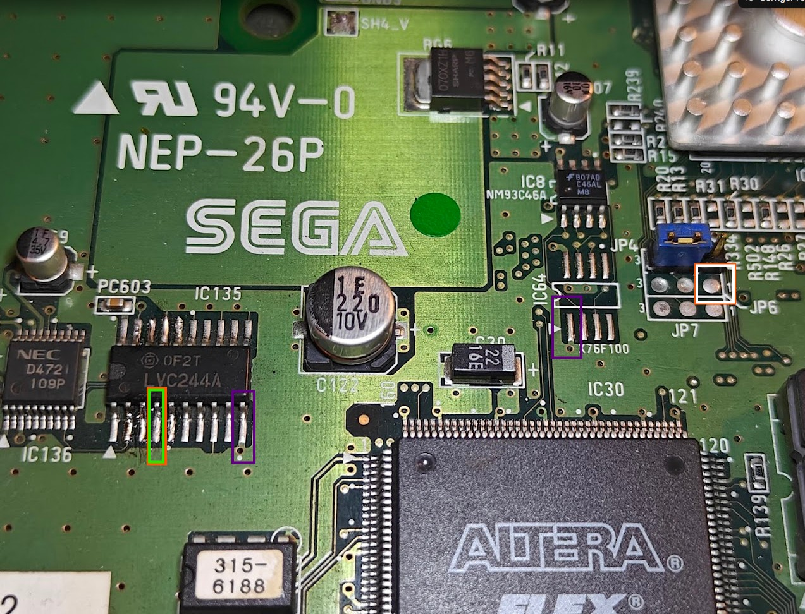

# Naomi 2 debug serial wiring

The photo below shows the connection points for the SH-4 SCIF debug serial
port on a Naomi 2. Signal names in the wiring table are given from the PC
serial adapter's perspective.

| Photo marking | Connect to the PC serial adapter | Naomi 2 signal |
| --- | --- | --- |
| Green square | RX (receive) | SH-4 TX (transmit) |
| White square | TX (transmit) | SH-4 RX (receive) |
| Purple markings | GND | Ground |

Connect the adapter's RX to the green point, its TX to the white point,
and its GND to one of the purple points. TX and RX are crossed between
the PC and the SH-4.

**Do not connect the serial adapter's VCC pin.** Power the Naomi 2 through
its normal power connection; only RX, TX and GND are connected to the adapter.

For the default NaomiDIAG build, set the terminal to **57600 baud, 8N1,
no flow control**. If the ROM was built with a different `BAUD` setting,
use that setting instead.
